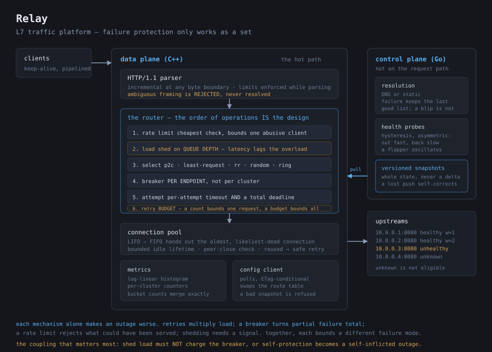

# 🛰️ Relay

*An L7 traffic platform with a C++ data plane and a Go control plane, where the interesting part turned out not to be forwarding requests but controlling how failure spreads.*



## 🔭 What It Is

A Layer-7 reverse proxy, split into two processes with opposite requirements.

The **C++ data plane** owns the request path: an HTTP/1.1 parser, upstream connection pooling, five load-balancing policies, and the failure-protection layer. The **Go control plane** owns configuration: it resolves endpoints from DNS or a static list, health-checks them, and publishes whole versioned snapshots that the data plane polls and applies without a restart.

That split is the design. The request path wants predictable microseconds and no locks on anything a request touches. Configuration wants retries, partial failure and DNS — work measured in seconds that changes shape as requirements do, and where a bug costs a stale endpoint list rather than a latency spike on every request. What crosses between them is always a complete snapshot, never a delta: a delta needs both sides to agree about the state it applies to, and they stop agreeing the first time a message is lost.

The part worth explaining is the failure protection, because each piece of it *alone* makes an outage worse:

| mechanism | alone, it… |
|---|---|
| retries | multiply load exactly when the upstream can least take it |
| circuit breakers | turn a partial failure total, and synchronise everyone's recovery probe |
| rate limits | reject traffic the system could have served |
| load shedding | needs a signal, and the obvious one (latency) lags the overload |

Together they work because each bounds a different failure mode. Retries are bounded by a **budget** rather than a count — at most some fraction of *successful* traffic, so a total outage drains the budget and retries stop rather than tripling. Breakers are **per endpoint**, because a per-cluster breaker takes healthy hosts out along with the sick one. Shedding keys on **queue depth**, which rises the moment arrival outpaces service, rather than on latency, which only rises once every queued request is already doomed.

And the coupling that is easiest to get wrong: **shed load must not charge the circuit breaker.** Shedding is the proxy protecting the upstream; if it trips the breaker, self-protection becomes a self-inflicted outage.

The HTTP parser rejects ambiguous framing rather than resolving it — `Content-Length` alongside `Transfer-Encoding`, duplicate `Content-Length`, obfuscated `chunked` — because any precedence rule the proxy applies is one the upstream may apply differently, and the gap between the two interpretations is request smuggling.

```
$ ./scripts/demo.sh
== 6. The data plane consumes the control plane's config
   control plane 127.0.0.1:9901: applied snapshot version 2
   30 requests through the control-plane-driven proxy:
       13 origin-9002
       17 origin-9003
   (9001 is absent: the proxy learned the endpoint set, it was not told)

== 9. Load shedding under a flood
        7 200
       33 503
   503s are the proxy refusing work deliberately, not timing out.
```

## ✨ Inspo

I wanted to know what is actually underneath "put it behind a load balancer". The forwarding part I could have guessed at.

What I could not have told you beforehand is why a retry *count* is the wrong way to bound retries. Three attempts per request bounds amplification per request at 3× and bounds it in aggregate at nothing — when everything starts failing, total upstream load triples at precisely the moment the upstream can least absorb it. A budget earned from successes inverts that: during a total outage there are no successes, so retries stop. Both the wrong version and the fix are in this repository's history.

The other thing I did not expect was how little of a request is actually my code. The whole decision path — parsing, balancing, every policy check — measures about 400 ns against a 114 µs request. The architecture costs 99.6% of it.

The reading behind it: [RFC 9112](https://www.rfc-editor.org/rfc/rfc9112) §6 for the framing rules the smuggling defences implement, Mitzenmacher on [*The Power of Two Choices*](https://www.eecs.harvard.edu/~michaelm/postscripts/handbook2001.pdf) for why two random samples get most of the benefit of a full scan, Karger et al. on [*Consistent Hashing*](https://www.cs.princeton.edu/courses/archive/fall09/cos518/papers/chash.pdf), Nygard's *Release It!* for circuit breakers as a design vocabulary, and [Envoy's architecture docs](https://www.envoyproxy.io/docs/envoy/latest/intro/arch_overview/arch_overview) for the retry-budget idea.

## 🛠️ Tech Stack

**C++20** for the data plane — parser, balancers, consistent hash ring, connection pool, circuit breakers, retry budget, rate limiter, load shedder, latency histogram, JSON reader, config client, and the server itself.

- Standard library only. No Boost, no Abseil, no HTTP library, no JSON library, no test framework.
- CMake, with `-Wall -Wextra -Wpedantic` clean and warning-free.
- AddressSanitizer/UndefinedBehaviorSanitizer and ThreadSanitizer as *separate* build directories, because clang refuses to combine them — and keeping them apart keeps what each one proves apart.
- The architecture is a bounded thread pool over blocking sockets with poll-based timeouts, not a single-threaded event-loop reactor. An event loop requires every stage to be resumable, which is the right design for C10k and several times the code; the cost of not doing it is measured rather than hidden.

**Go 1.24** for the control plane — resolution, health checking, snapshot versioning, and the HTTP API.

- Standard library only; `go.mod` has no `require` block.
- Resolution failures and probe failures are handled differently on purpose: a resolver failure keeps the last known endpoint list, because a DNS blip is not evidence that the endpoints are gone, while a failed probe *is* direct evidence about that endpoint and acts immediately.
- The data plane *pulls* configuration. Pushing would need the control plane to hold a connection to every proxy and track which pushes landed, which is a delivery problem with partial failure and the most common way a control plane ends up believing it shipped a config it did not.

**Build and verify**

```bash
cmake -S . -B build -DCMAKE_BUILD_TYPE=RelWithDebInfo && cmake --build build -j8
(cd build && ctest --output-on-failure)

cmake -S . -B build-asan -DRELAY_ASAN=ON && cmake --build build-asan -j8
(cd build-asan && ctest)

cd go-control-plane && go test -race ./... && cd ..

./scripts/demo.sh        # both halves, a dead origin, a config push, a flood
./build/relay-bench      # decision-path CPU
./scripts/stress.sh      # end-to-end throughput
```

195 C++ cases across 13 binaries and 41 Go tests, clean under ASAN, UBSAN and `-race`.

## 📄 License

MIT. See [LICENSE](LICENSE).
